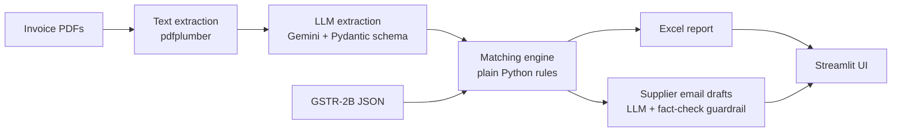

# GST Reconciliation Agent

An AI agent that helps small CA and accounting firms reconcile purchase invoices against GSTR-2B: it reads invoice PDFs, finds every mismatch, and drafts follow-up emails to suppliers.


**Demo video:** [https://lnkd.in/p/dX6prMS5]

**Live demo:** [open the app](https://gst-recon-agent.streamlit.app/)

## The problem

Every month, accountants compare their clients' purchase invoices with what suppliers reported on the GST portal (GSTR-2B), then chase suppliers about the differences. Done by hand, this takes days. Invoices missing from 2B can also put the client's input tax credit at risk.

## What it does

1. **Extracts** structured fields (supplier, GSTIN, invoice number, date, taxable value, CGST/SGST/IGST) from invoice PDFs using an LLM, validated against a strict schema.
2. **Matches** invoices against GSTR-2B using deterministic rules (no AI), and sorts each one into: matched, amount mismatch, invoice number written differently, or missing in 2B. It also lists invoices that are on the portal but not in the books.
3. **Reports** the result as a colour-coded Excel workbook with a follow-up sheet and the tax value at risk.
4. **Drafts** one email per supplier. The LLM writes it from verified facts, and a guardrail checks that every invoice number and amount appears. If the check fails, a plain template is used instead. Nothing is sent automatically.
5. **Web UI** (Streamlit) to run it all on sample data or your own files.

## Architecture



Design choices:
- **Rules for money, LLM for language.** Matching is deterministic so it is exact, free and testable. The LLM only handles messy document reading and email wording.
- **Every LLM output is validated.** Extraction goes through a Pydantic schema; emails go through a fact-check with a template fallback.
- **Built for free-tier APIs.** Results are cached per invoice, calls are paced, and failures retry and then fall back.
- **Human in the loop.** The system drafts; a person reviews and sends.

## Results

Measured on a synthetic test set of 60 invoices with a known answer key (`ground_truth.json`):

| Check | Result |
|---|---|
| Extraction, all 8 fields per invoice | 60/60 invoices fully correct |
| Matching status vs answer key | 60/60 correct, plus the 3 portal-only invoices found |

**Limitations (please read):** the test invoices are clean, digital PDFs in a single layout, so these numbers are best-case. Not yet tested on varied layouts, scanned or photographed invoices, or real GSTR-2B files. Fuzzy matching of badly mistyped invoice numbers is not implemented. All data is synthetic; GSTINs are fake and their checksum digit is not valid.

## Setup

Requires Python 3.11+ and a free Gemini API key from Google AI Studio.

```bash
git clone https://github.com/neilnakade/gst-recon-agent.git
cd gst-recon-agent
python -m venv .venv
source .venv/bin/activate        # Windows: .venv\Scripts\activate
pip install -r requirements.txt
cp .env.example .env             # Windows: copy .env.example .env
# then open .env and paste your key
```

## Run it

```bash
python -m src.gst_agent.synthetic --n 60 --seed 42     # make fake invoices + portal data + answer key
python -m src.gst_agent.extractor --limit 60           # read PDFs with Gemini (about 10 min on free tier)
python -m src.gst_agent.evaluate                       # extraction accuracy vs answer key
python -m src.gst_agent.matcher                        # reconcile books vs GSTR-2B
python -m src.gst_agent.report                         # Excel report -> output/
python -m src.gst_agent.emailer --company "Your Co"    # supplier email drafts -> output/emails/
streamlit run app.py                                   # web UI
```

## Project structure

```
app.py                      Streamlit web UI
src/gst_agent/
  synthetic.py              fake invoices, portal data, answer key
  extractor.py              PDF -> structured fields (Gemini + Pydantic)
  evaluate.py               extraction accuracy checker
  matcher.py                reconciliation rules
  report.py                 Excel report
  emailer.py                supplier email drafts with guardrail
```

## Roadmap

- Harder test set: varied layouts, scanned invoices (OCR), noisy formatting
- Fuzzy matching for mistyped invoice numbers
- Real GSTR-2B file format support
- Send emails via approved human review step
- Multi-client support

## Disclaimer

A portfolio project. It does not provide tax or legal advice, and its output should be reviewed by a qualified professional.
