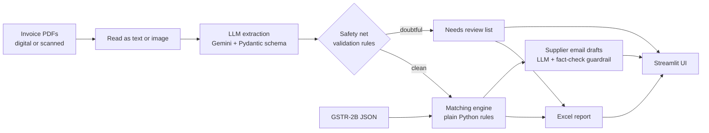

# GST Reconciliation Agent

An AI agent that helps small CA and accounting firms reconcile purchase invoices against GSTR-2B: it reads invoice PDFs (digital or scanned), sets aside anything it can't read reliably, finds every mismatch, and drafts follow-up emails to suppliers.


**Demo video:** [https://lnkd.in/p/dX6prMS5]

**Live demo:** [https://gst-recon-agent.streamlit.app/] (runs on pre-extracted sample data; the AI features are switched off in the public version)

## The problem

Every month, accountants compare their clients' purchase invoices with what suppliers reported on the GST portal (GSTR-2B), then chase suppliers about the differences. Done by hand, this takes days. Invoices missing from 2B can also put the client's input tax credit at risk.

## What it does

1. **Extracts** structured fields (supplier, GSTIN, invoice number, date, taxable value, CGST/SGST/IGST) from invoice PDFs using an LLM, validated against a strict schema. Digital PDFs are read as text; scanned or photographed invoices (no text layer) are read as page images.
2. **Checks its own work.** Plain rules reject placeholders ("unknown"), invalid GSTINs, impossible or out-of-month dates, inconsistent tax structure and non-standard tax rates. Anything doubtful goes to a **needs review** list and is never matched, so an unreadable invoice can't turn into a false "missing in 2B" alarm.
3. **Matches** the clean invoices against GSTR-2B with deterministic rules (no AI): matched, amount mismatch, invoice number written differently, or missing in 2B. It also lists invoices that are on the portal but not in the books.
4. **Reports** the result as a colour-coded Excel workbook with a follow-up sheet, a needs-review sheet, and the tax value at risk.
5. **Drafts** one email per supplier. The LLM writes it from verified facts, and a guardrail checks that every invoice number and amount appears. If the check fails, a plain template is used instead. Nothing is sent automatically.
6. **Web UI** (Streamlit) to run it all on sample data or your own files.

## Architecture



Design choices:
- **Rules for money, LLM for language.** Matching is deterministic so it is exact, free and testable. The LLM only handles messy document reading and email wording.
- **Never trust an LLM answer blindly.** Extraction goes through a Pydantic schema and then validation rules; emails go through a fact-check with a template fallback.
- **"I'm not sure" beats a silent wrong answer.** Doubtful invoices are set aside for a human instead of flowing into the reconciliation.
- **Built for free-tier APIs.** Results are cached per invoice, calls are paced, and failures retry and then fall back.
- **Human in the loop.** The system drafts; a person reviews and sends.

## Results

Measured against known answer keys on three synthetic test sets (all data is fake):

| Test set | What it contains | Invoices fully correct | Fields correct |
|---|---|---|---|
| Easy | 60 clean digital PDFs, one layout | 60/60 | 480/480 |
| Hard | 40 digital PDFs, 4 layouts, Indian number and date formats, multi-line items, distractor numbers (buyer GSTIN, PO, challan, bank details) | 40/40 | 320/320 |
| Simulated scans | The hard set turned into image-only PDFs at 3 quality levels (light, medium, heavy: tilt, blur, noise, shadow, compression) | 37/40 (92.5%) | 317/320 (99.1%) |

The three scan errors: a capital I read as a lowercase l in a supplier name, a space inserted into an invoice number, and one day/month swap (`05/09/2026` read as 9 May), which the safety net flags because the date falls outside the batch's usual month.

Matching: 60/60 statuses correct against the answer key on the easy set, including the invoices that exist only on the portal.

**Limitations (please read):**
- All data is synthetic: only 8 fake suppliers, small test sets (40 to 60 invoices), and scans simulated in code rather than photographed. One or two errors in 40 cannot pin down a true error rate.
- Not yet tested on real GSTR-2B files or real invoices.
- The safety net cannot catch a wrong invoice number that still looks plausible.
- Fuzzy matching of badly mistyped invoice numbers is not implemented.
- GSTINs are fake and their checksum digit is not valid.
- While building the test sets I found and fixed two bugs in my own test tooling (an over-strict name comparison and a shadow effect that blacked out invoice headers), which is why the evaluation script matches results by file and reports per-layout and per-quality breakdowns.

## Setup

Requires Python 3.11+ and a free Gemini API key from Google AI Studio.

```bash
git clone https://github.com/neilnakade/gst-recon-agent.git
cd gst-recon-agent
python -m venv .venv
source .venv/bin/activate        # Windows: .venv\Scripts\activate
pip install -r requirements.txt
cp .env.example .env             # Windows: copy .env.example .env
# then open .env and paste your key
```

## Run it

```bash
# 1. Easy set: generate, extract, evaluate, reconcile, report, emails
python -m src.gst_agent.synthetic --n 60 --seed 42
python -m src.gst_agent.extractor --limit 60           # about 10 min on the free tier
python -m src.gst_agent.evaluate
python -m src.gst_agent.matcher
python -m src.gst_agent.report
python -m src.gst_agent.emailer --company "Your Co"

# 2. Harder digital invoices
python -m src.gst_agent.synthetic_hard --n 40 --seed 7
python -m src.gst_agent.extractor --invoices data/hard/invoices --out data/hard/extracted --limit 40
python -m src.gst_agent.evaluate --truth data/hard/ground_truth.json --extracted data/hard/extracted

# 3. Simulated scans (read as images)
python -m src.gst_agent.make_scans
python -m src.gst_agent.extractor --invoices data/scanned/invoices --out data/scanned/extracted --limit 40
python -m src.gst_agent.evaluate --truth data/scanned/ground_truth.json --extracted data/scanned/extracted

# Web UI
streamlit run app.py
```

## Project structure

```
app.py                      Streamlit web UI
sample_data/                pre-extracted fake data for the hosted demo
src/gst_agent/
  synthetic.py              easy fake invoices, portal data, answer key
  synthetic_hard.py         harder invoices: 4 layouts, distractors, Indian formats
  make_scans.py             turns invoices into simulated scans
  extractor.py              PDF or scan -> structured fields (Gemini + Pydantic)
  evaluate.py               accuracy checker with per-layout and per-quality breakdowns
  validate.py               safety net: flags doubtful extractions for review
  matcher.py                reconciliation rules
  report.py                 Excel report
  emailer.py                supplier email drafts with guardrail
```

## Roadmap

- Real GSTR-2B file support (JSON/Excel) and testing on anonymized real files
- Test on real photographed invoices
- Fuzzy matching for mistyped invoice numbers; supplier-name clean-up by GSTIN
- Send emails after an explicit human approval step
- Multi-client support

## Disclaimer

A portfolio project. It does not provide tax or legal advice, and its output should be reviewed by a qualified professional.
